# Secure Remote Access to My Linux Homelab with Tailscale

**Lab 01.5 | Tailscale | Secure remote access | Device approval | OpenSSH | Ubuntu Server**

After finishing my [Linux Server Administration & Security Hardening lab](https://github.com/KingRichardVII/linux-server-security-hardening), I wanted a way to connect to my Ubuntu server when I wasn't at home.

I didn't want to open SSH to the public Internet through my router. Instead, I set up **Tailscale**, a private network that lets my laptop reach the server securely. I kept my existing SSH hardening and added two rules: **new devices need approval**, and **my laptop is allowed to reach the server on SSH port 22 only**.

The real test was connecting my laptop to my phone's cellular hotspot, away from my home Wi-Fi. **It worked:** I reached `linux01` and signed in with a separate SSH key created just for my laptop.

## What I wanted to prove

- An approved device could connect to my server from outside my home network.
- A device being approved didn't automatically mean it could access every service.
- My laptop's SSH key worked without copying the private key from my desktop.
- I could keep Proxmox management off Tailscale and avoid setting up router port forwarding for this lab.

## How the connection works

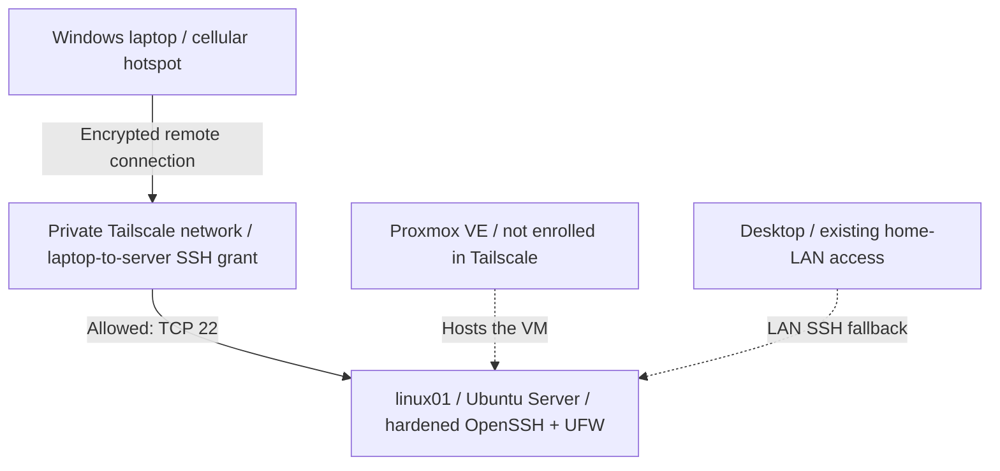

Only my laptop and the Ubuntu VM were added to Tailscale. The Proxmox host stayed separate, and I didn't configure subnet routing or an exit node.

| Component | Lab setup |
| --- | --- |
| Linux server | `linux01` — Ubuntu Server 26.04.1 LTS on Proxmox |
| Remote device | Windows laptop |
| Private networking | Tailscale (version `1.104.1` observed on Ubuntu) |
| SSH login | Standard OpenSSH with a passphrase-protected Ed25519 key |
| Access rule | Laptop → Ubuntu on `tcp:22` |
| Existing firewall | UFW, default deny incoming; LAN SSH rule retained |

## What I configured and tested

### 1. Required approval for new devices

I turned on **Manually approve new devices** in Tailscale. When I signed in on my laptop, it appeared as **Needs approval**. I had to approve it separately before it could use the private network.

That was an important distinction for me: **signing into an account isn't the same as being authorized to access a device**.

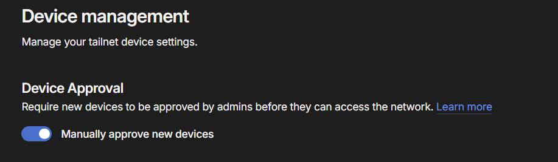

*Figure 1 — Manual approval required for new devices.*

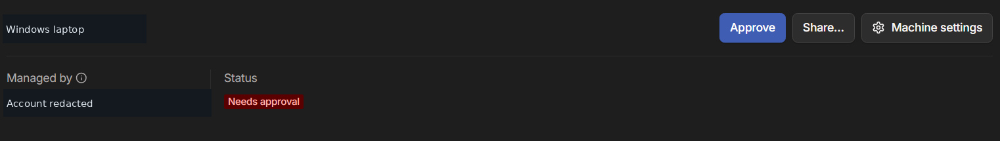

*Figure 2 — My laptop waiting for approval.*

### 2. Removed the default allow-everything rule

My new tailnet originally allowed all approved devices to reach each other on all ports. That was more access than I wanted for this lab.

I removed the broad rule and the unused Tailscale SSH rule. I'm still using **standard OpenSSH**, not Tailscale's separate SSH feature.

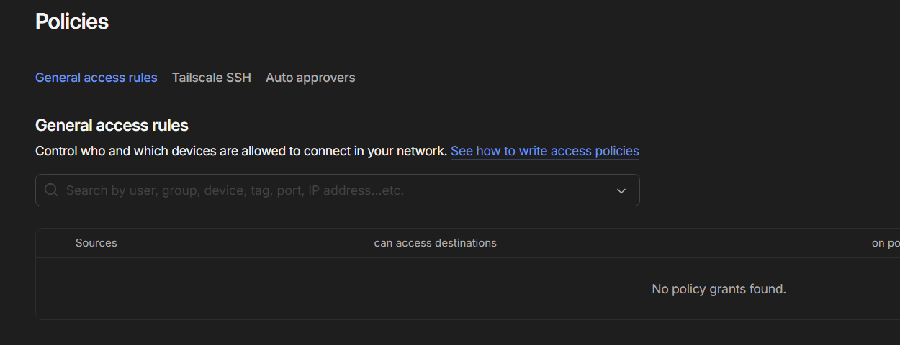

*Figure 3 — No general network-access grants before adding my SSH rule.*

### 3. Allowed only laptop-to-server SSH

I added a single network **grant** allowing my laptop to connect to `linux01` on **TCP port 22**. I didn't grant access to all devices or all ports.

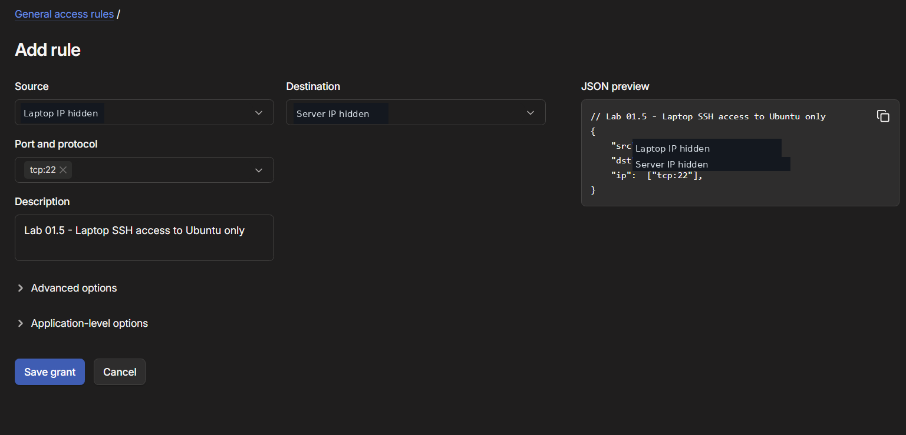

*Figure 4 — One laptop, one destination, and one allowed service.*

The example configuration is in [`configs/ssh-grant-example.json`](configs/ssh-grant-example.json). The actual rule uses device Tailscale addresses; if those addresses change, the rule may need to be updated.

### 4. Tested the connection before and after the grant

I wanted to see whether the rule actually changed anything, so I tested the same connection twice using PowerShell's `Test-NetConnection`.

| Test | Result |
| --- | --- |
| Laptop → Ubuntu TCP/22 **before** adding the grant | `False` — couldn't connect |
| Laptop → Ubuntu TCP/22 **after** adding the grant | `True` — could connect |

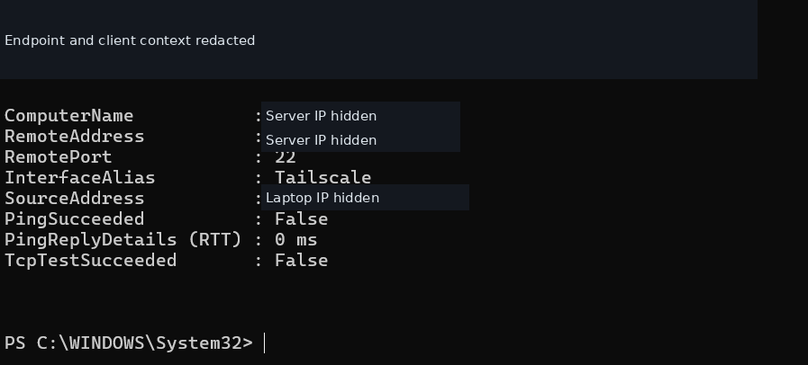

*Figure 5 — SSH port unreachable before I allowed the connection.*

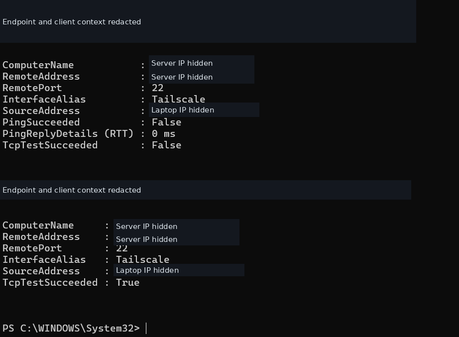

*Figure 6 — The same test succeeded after I saved the grant.*

This was strong evidence that the restricted access setup was working as intended. The tests don't, by themselves, identify every firewall component involved.

### 5. Gave my laptop its own SSH key

My desktop already had a working SSH key from Lab 01. Instead of copying its private key, I generated a new **Ed25519 key pair** on my laptop and added only the laptop's public key to Ubuntu's `authorized_keys` file.

I checked the file permissions (`700` for `.ssh`, `600` for `authorized_keys`) and compared the server's SSH host-key fingerprint before accepting the connection. My desktop's original key stayed authorized, so the two devices can be managed separately.

### 6. Connected from outside my home network

This was the test I cared about most. I disconnected my laptop from home Wi-Fi, connected it to my phone's **cellular hotspot**, and ran the SSH connection test again.

Port 22 was reachable, and I successfully logged into Ubuntu using my laptop's own key. On the server, I checked `hostname`, `whoami`, and `SSH_CONNECTION` to confirm the session reached `linux01` over the Tailscale addresses.

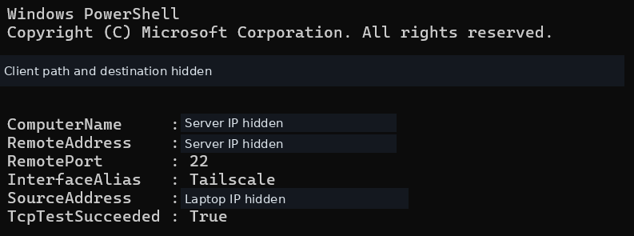

*Figure 7 — SSH port reachable while my laptop was using the hotspot.*

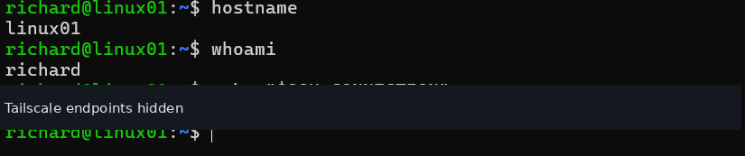

*Figure 8 — Successful SSH session from outside my home network.*

### 7. Checked that another port wasn't reachable

To make sure I wasn't accidentally granting access to everything, I started a temporary Python HTTP server on **TCP/8080** and tried reaching it from my laptop.

The connection failed (`TcpTestSucceeded : False`), even though SSH on port 22 worked. I then stopped the temporary server and verified the listener was gone.

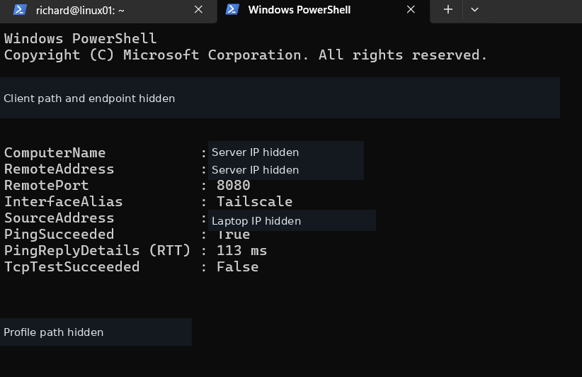

*Figure 9 — Port 8080 was not reachable from the laptop.*

That result is **consistent with the restricted policy**, but I didn't separately prove whether Tailscale's rules or Ubuntu's UFW rules were responsible for blocking this particular connection.

## Final checks

After testing, I confirmed that Tailscale and SSH were still running, UFW was still enabled with its original LAN SSH rule, and nothing was listening on port 8080. Tailscale also showed both enrolled devices and reported a **direct** connection at that checkpoint.

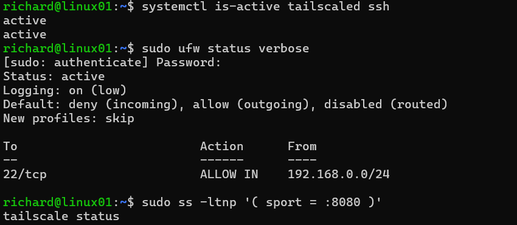

*Figure 10 — Server services, firewall, and temporary-test cleanup verified.*

## What went wrong and what I learned

My biggest takeaway is that **secure remote access takes more than installing a VPN**. I had to think about which devices were trusted, which connections were allowed, and which SSH key could actually log in.

I also ran into a surprisingly simple problem while transferring my laptop's public key: copying the next PowerShell command replaced the public key in my clipboard. Once I noticed that, I verified the key before transferring it through my already-trusted desktop SSH connection. It was a good reminder to check each step instead of assuming the problem was with the server.

## Scope and limitations

This is a personal homelab, not a complete enterprise Zero Trust deployment or security audit. The tests show that the configured SSH connection worked and that TCP/8080 was unreachable in the tested setup; they don't prove every possible access path is blocked.

I used device IP addresses in my Tailscale grant, which may need updating if a device is re-enrolled. I tested the external connection using one cellular-hotspot network. I didn't configure Tailscale SSH, subnet routing, an exit node, or remote access to the Proxmox management interface, and I didn't independently audit every router setting.

Public screenshots are sanitized to hide personal information, account details, and unnecessary network identifiers. Originals remain private.

## Documentation

- [Full setup notes and commands](docs/implementation.md)
- [Security tests and results](docs/security-validation.md)
- [Troubleshooting notes](docs/troubleshooting.md)
- [Screenshot and privacy notes](docs/evidence-manifest.md)
- [Example Tailscale access grant](configs/ssh-grant-example.json)

**Previous project:** [Lab 01 — Linux Server Administration & Security Hardening](https://github.com/KingRichardVII/linux-server-security-hardening)

**Next major lab:** Splunk SIEM and Linux Security Monitoring.
