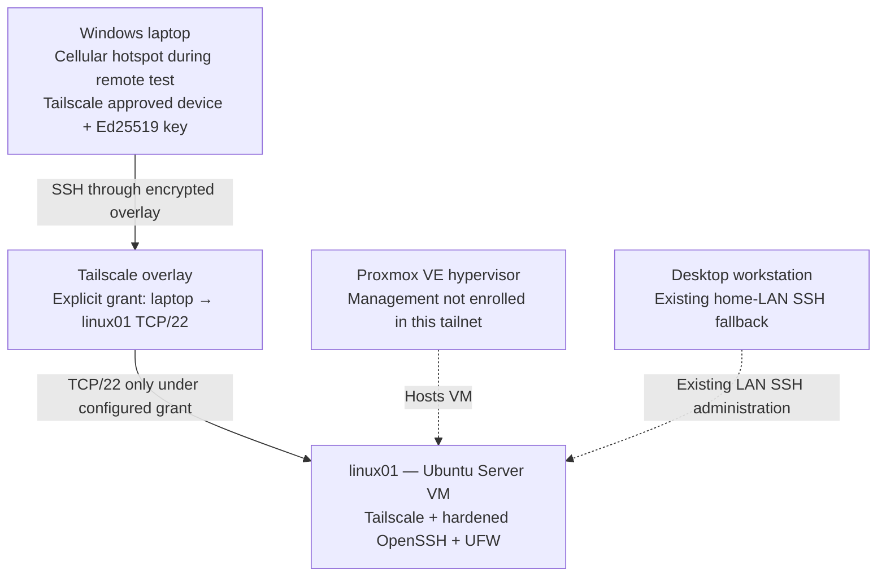

# Secure Remote Access to a Linux Homelab with Tailscale

**Lab 01.5 | Tailscale · Device Approval · Least-Privilege Network Grants · OpenSSH · Ubuntu Server · Proxmox VE**

I configured Tailscale so I could securely administer my home Ubuntu server from my Windows laptop when I'm away from home. I kept the SSH hardening from my [Linux Server Administration & Security Hardening](https://github.com/KingRichardVII/linux-server-security-hardening) project and added two more layers: **manual device approval** and a **network grant limited to SSH on TCP/22**.

I tested the configuration from my phone's cellular hotspot, not just from my home Wi-Fi. The laptop reached the server through Tailscale and authenticated using its own passphrase-protected Ed25519 SSH key. I also tested denied connections before adding the grant and on a separate port afterward.

> **Result:** Remote SSH worked over Tailscale from an external network. The access policy allowed a specific laptop-to-server TCP/22 connection without granting general access to other tailnet services. This is a personal educational homelab, not a production Zero Trust deployment.

## Architecture

No home-router port-forwarding changes were needed for this setup. The Proxmox management interface was **not** added to Tailscale. Only the Ubuntu guest and Windows laptop were enrolled.

## Environment

| Component | Lab setup |
|---|---|
| Hypervisor | Dedicated Proxmox VE host |
| Server | `linux01`, Ubuntu Server 26.04.1 LTS virtual machine |
| Server networking | Bridged home LAN plus a Tailscale interface |
| Remote client | Windows laptop, joined to the same personal tailnet |
| VPN software | Tailscale 1.104.1 observed on Ubuntu |
| Server authentication | OpenSSH, Ed25519 public-key authentication, password login disabled |
| Host firewall | UFW, default-deny inbound with an existing LAN-specific SSH rule |
| Tailnet policy | Manual device approval; explicit laptop → Ubuntu `tcp:22` grant |

## Implementation and security controls

### 1. Require device approval

I enabled **Manually approve new devices** in Tailscale's admin console. My laptop could sign in to the account but appeared as **Needs approval** until I approved it separately. That demonstrated the difference between account authentication and device authorization.

*Figure 1 — New tailnet devices require manual approval.*

*Figure 2 — The laptop was enrolled but awaiting administrator approval; account and device identifiers were sanitized.*

### 2. Replace the default allow-all policy

The new tailnet initially allowed all devices to connect to all other devices on all ports. I removed that rule, leaving **no general access grants**. I also removed the default **Tailscale SSH** rule because this lab uses standard OpenSSH with the existing hardened server configuration instead.

*Figure 3 — The allow-all rule was removed before testing new connections.*

### 3. Grant exactly one SSH connection

I added one grant permitting the approved laptop to initiate **TCP/22 to `linux01`**. The grant used the two devices' current Tailscale IPv4 addresses as selectors, not an all-users or all-ports rule.

*Figure 4 — One source, one destination, and one protocol/port (`tcp:22`). Exact device addresses are hidden.*

The sample policy structure, with placeholders instead of live addresses, is in [`configs/ssh-grant-example.json`](configs/ssh-grant-example.json). Address-based rules will need updating if a device's assigned Tailscale address changes. A tag-based policy may be a better long-term design.

### 4. Test DENY before ALLOW

On the laptop, `Test-NetConnection` to the server's Tailscale address on port 22 **failed before the grant** and **succeeded after the grant**.

| Test | Observed outcome |
|---|---|
| Before the grant: laptop → server TCP/22 | `TcpTestSucceeded : False` |
| After the grant: laptop → server TCP/22 | `TcpTestSucceeded : True` |

*Figures 5–6 — A before/after connection test. The change is consistent with the explicitly authorized Tailscale policy; the tests alone do not isolate every firewall layer involved.*

### 5. Keep separate SSH credentials for separate devices

I generated a separate, passphrase-protected **Ed25519 SSH key** on the laptop instead of copying my desktop's private key. I appended **only the laptop's public key** to `richard`'s `~/.ssh/authorized_keys` on Ubuntu, preserving the desktop's existing key.

I verified `.ssh` permissions (`700`), `authorized_keys` permissions (`600`), and the server's SSH host-key fingerprint before accepting the laptop's first connection over Tailscale. The separate public-key entries make it possible to revoke laptop access independently of the desktop.

### 6. Confirm remote administration from a different network

I disconnected the laptop from my home Wi-Fi, used a phone's **cellular hotspot**, and repeated the tests. TCP/22 remained reachable through Tailscale; SSH authenticated using the laptop's dedicated key.

On the server, `hostname` returned `linux01` and `whoami` returned `richard`. The `SSH_CONNECTION` environment variable showed a Tailscale-to-Tailscale connection terminating on port 22. Exact endpoints have been redacted from the public screenshot.

*Figures 7–8 — Verified TCP reachability and authenticated remote administration while the laptop used an external cellular connection.*

### 7. Test a separate, ungranted service port

I started a temporary Python HTTP listener on Ubuntu, bound to its Tailscale address on **TCP/8080**, and tested connectivity from the laptop. Port 8080 returned `TcpTestSucceeded : False`, even though TCP/22 was reachable. I stopped the test server with `Ctrl+C` and later confirmed no listener remained on port 8080.

*Figure 9 — TCP/8080 was unreachable. This is consistent with the restricted network grant, but UFW and Tailscale's Linux firewall integration were not independently isolated in this test.*

## Final validation

Both `tailscaled` and OpenSSH remained active. UFW still showed the original **default-deny incoming** policy and **LAN-only TCP/22 rule**. No TCP/8080 listener remained after cleanup. `tailscale status` showed the Ubuntu server and Windows laptop connected; at the recorded checkpoint, the connection was reported as **direct** rather than relayed.

*Figure 10 — Service state, firewall policy, and temporary-listener cleanup. External peer addresses were excluded from this public capture.*

## What I learned

The biggest lesson was that remote access isn't just about creating an encrypted connection. I needed to decide **which devices could join, which traffic was authorized, and which SSH key could log in**. Testing before and after a policy change showed why it is important to check actual behavior rather than trust a configuration screen alone.

I also ran into a workflow issue while installing the laptop's public key: copying a command replaced the key contents in the clipboard. I corrected the process by verifying the key before transferring it and then using an existing trusted SSH connection to append the public key without replacing the desktop key. This reinforced the value of small verification checkpoints and clear documentation.

## Scope and limitations

- **Not a complete endpoint or network security audit.** Device approval, a scoped grant, and key-based SSH were configured and tested; they do not guarantee protection against every attack.
- **Port 8080 denial was observed but not attributed to a single layer.** Tailscale's Linux netfilter integration and UFW can both affect reachability. The test shows the connection failed, not which specific rule caused it.
- **Tailscale device selectors were IPv4 addresses.** They are specific, but can require updates if a device is re-enrolled or its address changes.
- **No router port forwarding was configured as part of this lab.** The router's entire existing configuration was not independently audited.
- **No subnet router, exit node, Tailscale SSH, or direct Proxmox remote management** was set up.
- **The external test used one cellular-hotspot network.** Results on other networks and under different NAT/firewall conditions may vary; direct vs. relayed Tailscale connectivity can also change.
- **The screenshots are sanitized.** Public images intentionally mask endpoint addresses, account details, and local Windows profile paths; original captures remain private.

## Documentation

- [Implementation steps and commands](docs/implementation.md)
- [Security validation matrix](docs/security-validation.md)
- [Troubleshooting and lessons learned](docs/troubleshooting.md)
- [Screenshot evidence and sanitization notes](docs/evidence-manifest.md)
- [Example Tailscale SSH-only network grant](configs/ssh-grant-example.json)

**Related project:** [Lab 01 — Linux Server Administration & Security Hardening](https://github.com/KingRichardVII/linux-server-security-hardening)
This project builds on my original Linux security hardening lab, where I configured least-privilege permissions, hardened OpenSSH, implemented UFW firewall rules, investigated authentication logs, and performed Linux system administration.
